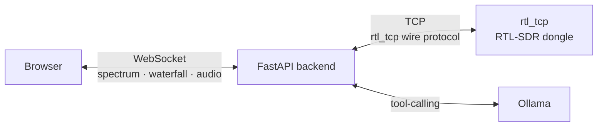

# Wideband-SDR

[](https://github.com/kasp0r/wideband-sdr/actions/workflows/ci.yml)
[](https://www.python.org/)
[](https://www.docker.com/)
[](LICENSE)

Wideband-SDR turns a cheap **RTL-SDR** USB dongle into a web radio you can tune from any
browser. Plug in a dongle, point the app at it, and you get:

- a **live spectrum and waterfall** — a moving picture of the radio spectrum around your
  tuned frequency, so you can *see* stations and signals,
- **audio** you can actually listen to — FM broadcast, AM, air traffic, ham bands, and
  more,
- an **AI assistant** you can ask in plain English ("find the strongest FM stations",
  "what am I hearing right now?") that drives the radio for you.

No specialised radio hardware beyond the dongle is needed, and the whole thing runs in a
single Docker container.

### New to SDR?

*Software-defined radio (SDR)* means the tuning and decoding that used to live in
physical radio circuits now happens in software. An **RTL-SDR** is a ~$25 USB stick
(originally sold for digital TV) that becomes a general-purpose receiver covering roughly
25 MHz – 1.7 GHz — enough for FM radio, air-traffic control, weather satellites, ham
radio, and much more.

### For experienced SDR users

Wideband-SDR is a browser front end plus a FastAPI backend that speaks the classic
**rtl_tcp** wire protocol directly (no `pyrtlsdr` dependency) and runs the DSP (FFT +
demodulation) server-side. An **Ollama** tool-calling agent adds a natural-language control
plane on top — `tune`, `scan`, `characterize`, `optimize`, and more.



The backend is the **single** client to `rtl_tcp` (rtl_tcp only accepts one client at a
time). It owns the radio, does the DSP, and multiplexes results out to any number of
browsers.


## Contents

- [Features](#features)
- [Supported hardware](#supported-hardware)
- [First-time dongle setup (Linux)](#first-time-dongle-setup-linux)
- [Quick start](#quick-start)
- [Setting up Ollama](#setting-up-ollama)
- [Testing](#testing)
- [Configuration (environment variables)](#configuration-environment-variables)
- [Running rtl_tcp](#running-rtl_tcp)
- [API overview](#api-overview)
- [How signal identification works](#how-signal-identification-works)
- [Limitations / next steps](#limitations--next-steps)
- [License](#license)
- [Contributing](#contributing)

## Features

- **Live spectrum + waterfall** with a frequency axis, peak labels, click-to-tune, a
  centre/tuned-frequency line, and a passband overlay showing the demod filter width.
  **Zoom** into any region with the mouse wheel or the zoom slider (double-click to
  reset; smallest zoom set by `MIN_SPAN_HZ`), and **smooth** the trace with the Smooth
  slider.
- **Themes** — pick Black, Dark, Midnight, Amber, Light, Solarized, Nord, or Terminal
  (phosphor-green) from the top-right selector; your choice is remembered.
- **Audio demodulation** — AM / NBFM / WFM / USB / LSB, with a bandwidth control, volume,
  FM de-emphasis (50/75 µs), and a soft limiter to reduce clipping.
- **AI assistant** (Ollama tool-calling) that can *control* the radio and *reason* about
  the spectrum:
  - `get_status` / `get_spectrum` / `get_signal_metrics` — inspect state and signal quality,
  - `tune` / `fine_tune` — move or nudge the receiver,
  - `scan` — sweep a band and report detected signals,
  - `characterize` — estimate bandwidth and likely modulation,
  - `set_demod_mode` / `set_bandwidth` / `set_sample_rate` / `set_gain` — full control,
  - and an "optimise the signal" flow that measures, corrects, re-measures, and reports.

## Supported hardware

Wideband-SDR currently supports **RTL-SDR dongles** (RTL2832U with an R820T/R828D
tuner), accessed over the classic `rtl_tcp` protocol.

Other devices such as the **Airspy HF+ Discovery**, Airspy R2/Mini, SDRplay, and
HackRF are **not** currently supported. These use different drivers (`airspyhf`,
SoapySDR, …) and, when served over a network, expose their own protocols (e.g.
Airspy's `spyserver`) rather than `rtl_tcp`, so they can't simply be pointed at as an
`SDR_HOST`.

Adding support for other SDRs is feasible: the backend's only hardware interface is
`backend/rtltcp.py`, and the radio core just reads raw I/Q and issues a few control
calls (`set_center_freq`, `set_sample_rate`, `set_gain`). A new client implementing
those methods — either a dedicated `airspyhf` client or a SoapySDR client (which
would unlock many devices at once) — would slot in alongside it. Note that some
devices (e.g. the HF+ Discovery) top out below the RTL-SDR's 2.4 MHz sample rate, so
the visible spectrum span would be correspondingly narrower.

## First-time dongle setup (Linux)

Do this once per machine that has the dongle plugged in. It gets you from "new USB
stick" to a running `rtl_tcp` server, which is what the app connects to.

### 1. Install the RTL-SDR tools

`rtl_tcp` and `rtl_test` come from your distro's `rtl-sdr` package:

```bash
sudo dnf install rtl-sdr        # Fedora
sudo apt install rtl-sdr        # Debian / Ubuntu / Raspberry Pi OS
sudo pacman -S rtl-sdr          # Arch
```

On macOS, `brew install librtlsdr` provides the same tools.

### 2. Keep the kernel's TV driver off the dongle

RTL-SDR sticks started life as digital-TV tuners, so Linux loads a DVB-T TV driver
(`dvb_usb_rtl28xxu`) when you plug one in. While that driver holds the stick,
`rtl_test` and `rtl_tcp` can't open it. Some distro packages block the driver for
you; check whether it's loaded:

```bash
lsmod | grep dvb_usb_rtl28xxu
```

If that prints anything, block the driver and unload it (no reboot needed):

```bash
echo 'blacklist dvb_usb_rtl28xxu' | sudo tee /etc/modprobe.d/blacklist-rtlsdr.conf
sudo modprobe -r dvb_usb_rtl28xxu rtl2832
```

### 3. Check the dongle

Plug it in and run:

```bash
rtl_test -t
```

You should see the tuner named, e.g. `Found Rafael Micro R820T tuner`. Press Ctrl-C
to stop.

| You see | It means |
|---|---|
| `usb_claim_interface error -6` | The TV driver still has the stick. Redo step 2. |
| `No supported devices found` | Not plugged in, or not seen over USB. Check `lsusb` for a `0bda:2838` Realtek device. |
| `usb_open error -3` | Permissions. Your distro's `rtl-sdr` package normally installs udev rules for this; unplug and replug the stick after installing. |

### 4. Start rtl_tcp

```bash
rtl_tcp -a 127.0.0.1 -p 1234
```

Leave it running in its own terminal. `127.0.0.1` keeps the dongle private to this
machine; use `-a 0.0.0.0` only if the app runs on a different machine (see
[Running rtl_tcp](#running-rtl_tcp)).

> [!IMPORTANT]
> `rtl_tcp` opens the dongle once, at startup. If the computer sleeps or the stick
> is unplugged, `rtl_tcp` keeps running but holds a stale handle: the app connects,
> gets no samples, and drops the connection every few seconds. **Restart `rtl_tcp`**
> (Ctrl-C, then run it again); the app reconnects on its own.

## Quick start

### 1. Prerequisites

- The rtl_tcp server running (see
  [First-time dongle setup](#first-time-dongle-setup-linux)).
- Ollama running and a tool-capable model pulled, e.g.:
  ```bash
  ollama pull gemma4   # or any tool-capable model you prefer
  ```

### 2. Run with Docker

```bash
docker compose up --build
```

Open http://localhost:8000

> [!TIP]
> The default rtl_tcp target is `127.0.0.1:1234`. If your dongle is on another
> machine, set `SDR_HOST` (and `SDR_PORT`) to its address — either by copying
> `.env.example` to `.env` and editing it, or by exporting the variable before
> `docker compose up`.

The app uses **host networking**, so `localhost:11434` inside the container reaches
Ollama running on the host (Ollama binds to `127.0.0.1` by default). If Ollama runs
on a different machine, set `OLLAMA_URL` accordingly.

### 3. Run without Docker (development)

```bash
python3 -m venv .venv && source .venv/bin/activate
pip install -r requirements.txt
cp .env.example .env              # then edit, e.g. OLLAMA_MODEL
set -a; source .env; set +a       # export the settings into this shell
cd backend
uvicorn main:app --host 127.0.0.1 --port 8000
```

Only Docker Compose reads `.env` automatically; the backend itself reads the process
environment, hence the `source` line. Use `--host 0.0.0.0` instead if you want to
open the app from other machines on your network (it has no login).

> [!NOTE]
> The app speaks the classic rtl_tcp wire protocol directly (see `backend/rtltcp.py`) —
> it does *not* depend on `pyrtlsdr`, whose `RtlSdrTcpClient` uses an incompatible JSON
> protocol meant for its own server.

## Setting up Ollama

The AI assistant uses [Ollama](https://ollama.com) to run a local model that can call
tools (tune, scan, characterize, …).

1. Install Ollama: <https://ollama.com/download>
   (Linux: `curl -fsSL https://ollama.com/install.sh | sh`).
2. Pull a **tool-capable** model, e.g.:

   ```bash
   ollama pull gemma4          # or llama3.1, qwen2.5, …
   ```

   The model must support **function/tool calling** — most modern models do, but very
   small or legacy models may not.
3. Confirm it's running:

   ```bash
   ollama list      # lists pulled models
   ollama serve     # starts the API server (default http://localhost:11434)
   ```

The app connects to `OLLAMA_URL` (default `http://localhost:11434`) with `OLLAMA_MODEL`
(default `gemma4:latest`). You can also switch models live via the dropdown in the
assistant header.

## Testing

```bash
python3 -m venv .venv && source .venv/bin/activate
pip install -r requirements.txt -r requirements-dev.txt
pytest                          # backend tests
node --test tests/frontend.test.js   # frontend tests
```

The backend suite (`tests/`) covers the DSP (FFT / peak detection / signal metrics), the
demodulators (synthetic AM/FM/SSB tones, bandwidth filtering, de-emphasis, soft limiter),
the rtl_tcp wire protocol (mock server), and the
AI tool dispatch. The frontend tests cover the pure helpers in `frontend/lib.js`
(markdown rendering, frequency formatting, Ollama URL parsing).

## Configuration (environment variables)

| Variable          | Default           | Description |
|-------------------|-------------------|-------------|
| `SDR_HOST`        | `127.0.0.1`       | rtl_tcp host |
| `SDR_PORT`        | `1234`            | rtl_tcp port |
| `SAMPLE_RATE`     | `2400000`         | SDR sample rate |
| `FFT_SIZE`        | `8192`            | FFT bins per frame |
| `AVERAGES`        | `2`               | frames averaged per update |
| `MIN_SPAN_HZ`     | `250000`          | smallest zoom span in the UI (Hz) |
| `DEFAULT_FREQ`    | `100000000`       | startup frequency (Hz) |
| `DEFAULT_GAIN`    | `auto`            | startup gain |
| `DEFAULT_DEMOD`   | `wfm`             | startup demodulation mode |
| `AUTO_CONNECT`    | `1`               | connect to rtl_tcp on startup |
| `FREQ_CORRECTION` | `0`               | RTL-SDR crystal correction (ppm) |
| `RECONNECT_DELAY` | `2`               | reconnect backoff base (seconds) |
| `RECONNECT_MAX_DELAY` | `30`          | reconnect backoff cap (seconds) |
| `OLLAMA_URL`      | `http://localhost:11434` | Ollama API base |
| `OLLAMA_MODEL`    | `gemma4:latest`   | model name (must support tools) |
| `MAX_HISTORY_MESSAGES` | `40`          | max chat-history messages sent to the model |
| `MAX_SIGNALS`     | `10`              | max signals returned per tool call |
| `METRICS_INTERVAL` | `4`              | recompute signal metrics every N frames |

## Running rtl_tcp

> [!WARNING]
> rtl_tcp accepts only **one client at a time**. If a previous client disconnected
> uncleanly, rtl_tcp can get stuck — restart it if new connections hang.

On the machine with the dongle:

```bash
rtl_tcp -a 0.0.0.0 -p 1234
```

Notes:
- **Auto-reconnect.** If the connection drops mid-stream, the backend marks itself
  disconnected and retries with exponential backoff (`RECONNECT_DELAY` up to
  `RECONNECT_MAX_DELAY`).
- **Crystal correction.** If tuning is slightly off, set
  `FREQ_CORRECTION` to your dongle's ppm offset (e.g. `28`), which corrects both the
  tuned frequency and the effective sample rate.
- Keep sample rate ≤ ~2.4 MS/s (rtl_tcp / USB limit). The app defaults to 2.4 MS/s.
- **After sleep or unplugging**, restart `rtl_tcp`: it keeps a handle to the old USB
  device, and the app will connect and drop every few seconds until you do.

<details>
<summary>Managing rtl_tcp with sdr-server-stack</summary>

Instead of running `rtl_tcp` by hand, you can manage it with
[sdr-server-stack](https://github.com/kasp0r/sdr-server-stack) — a dependency-light
set of shell scripts that run one `rtl_tcp` server per attached RTL-SDR dongle on a
single host. This is handy when you serve your dongle(s) from a dedicated SDR host
machine.

On the SDR host:

```bash
git clone https://github.com/kasp0r/sdr-server-stack.git
cd sdr-server-stack
./sdr list              # confirm your dongles are detected
./sdr init              # generate sdr.conf (one rtl_tcp server per free dongle)
./sdr start <name>      # start a server (name comes from sdr init / sdr.conf)
./sdr status            # confirm it's running and on which port
```

Then point Wideband-SDR at it by setting `SDR_HOST` to the SDR host's address and
`SDR_PORT` to the port assigned in `sdr.conf` (the first dongle defaults to `1234`,
the next to `1235`, and so on). To serve several dongles at once, run one Wideband-SDR
instance per port, or switch dongles by changing `SDR_PORT`.

</details>

## API overview

- `GET /api/status` — connection and tuning status.
- `POST /api/connect` `{host, port}` / `POST /api/disconnect`.
- `POST /api/tune` `{freq_hz}` / `POST /api/gain` `{gain}` / `POST /api/sample_rate`.
- `POST /api/chat` `{message, history}` — one AI turn (agent loop with tools).
- `WS /ws` — streams `{type:"spectrum", center_hz, sample_rate, min_span_hz, demod_mode, bandwidth, band, metrics, power}` (the `power` array is the spectrum; the frequency axis is uniform and reconstructed client-side);
  accepts `{type:"tune"|"gain"|"sample_rate"|"freq_correction"|"config"}` messages.
- `WS /ws/audio` — streams float32 mono PCM at 48 kHz; accepts
  `{type:"config", mode, bandwidth, deemphasis}` messages.

## How signal identification works

The LLM is *not* fed raw IQ or pixels. Deterministic DSP computes features — occupied
**bandwidth**, **center frequency**, **relative power**, **SNR**, **tuning error** — and a
band-plan lookup. The model receives a structured summary plus its own knowledge of the
radio spectrum, then reasons about likely signal types (FM broadcast, airband AM, ADS-B,
NOAA APT, amateur digital modes, etc.). `characterize` and `get_signal_metrics` return
these features; `scan` returns a list of them.

## Limitations / next steps

- Modulation "hints" are bandwidth heuristics, not a full classifier (no cyclostationary
  analysis). SSB has no BFO/pitch fine-tune yet.
- The waterfall colormap is fixed (turbo); the noise floor is adjustable via the Floor
  slider, but there is no auto-range yet.
- The app talks the rtl_tcp wire protocol directly (`backend/rtltcp.py`) rather than
  depending on `pyrtlsdr`, whose TCP client is incompatible with classic rtl_tcp.

## License

MIT — see [LICENSE](LICENSE).

## Contributing

See [CONTRIBUTING.md](CONTRIBUTING.md) for development setup and guidelines.
