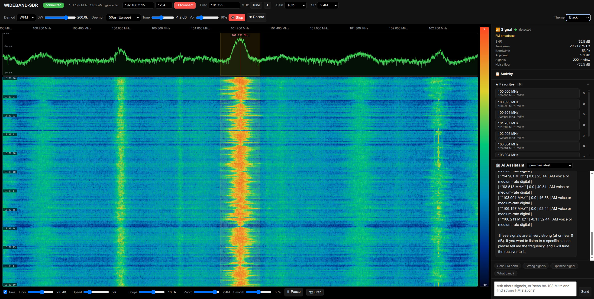

# Wideband-SDR

A Dockerised web app that connects to an **rtl_tcp** SDR server (e.g. an RTL-SDR dongle),
streams a live spectrum/waterfall to the browser, demodulates audio you can listen to,
and adds an **Ollama**-powered assistant
that can control the radio, scan bands, and help identify and optimise signals.

```
[Browser] ──WS──▶ [FastAPI backend] ──TCP──▶ rtl_tcp @ 127.0.0.1:1234
   ▲                  │  DSP (FFT, demod)
   │                  └──▶ Ollama (tool-calling agent)
   └── spectrum/waterfall, audio
```

The backend is the **single** client to `rtl_tcp` (rtl_tcp only accepts one client at a
time). It owns the radio, does the DSP, and multiplexes results out to any number of
browsers.



## Features

- **Live spectrum + waterfall** with a frequency axis, peak labels, click-to-tune, a
  centre/tuned-frequency line, and a passband overlay showing the demod filter width.
  **Zoom** into any region with the mouse wheel or the zoom slider (double-click to
  reset; smallest zoom set by `MIN_SPAN_HZ`), and **smooth** the trace with the Smooth
  slider.
- **Themes** — pick Black, Dark, Midnight, Amber, Light, Solarized, Nord, or Terminal
  (phosphor-green) from the top-right selector; your choice is remembered.
- **Audio demodulation** — AM / NBFM / WFM / USB / LSB, with a bandwidth control, volume,
  FM de-emphasis (50/75 µs), and a soft limiter to reduce clipping.
- **AI assistant** (Ollama tool-calling) that can *control* the radio and *reason* about
  the spectrum:
  - `get_status` / `get_spectrum` / `get_signal_metrics` — inspect state and signal quality,
  - `tune` / `fine_tune` — move or nudge the receiver,
  - `scan` — sweep a band and report detected signals,
  - `characterize` — estimate bandwidth and likely modulation,
  - `set_demod_mode` / `set_bandwidth` / `set_sample_rate` / `set_gain` — full control,
  - and an "optimise the signal" flow that measures, corrects, re-measures, and reports.

## Quick start

### 1. Prerequisites

- The rtl_tcp server running (see below).
- Ollama running and a tool-capable model pulled, e.g.:
  ```bash
  ollama pull gemma4   # or any tool-capable model you prefer
  ```

### 2. Run with Docker

```bash
docker compose up --build
```

Open http://localhost:8000

> **SDR host.** The default rtl_tcp target is `127.0.0.1:1234`. If your dongle is on
> another machine, set `SDR_HOST` (and `SDR_PORT`) to its address — either by copying
> `.env.example` to `.env` and editing it, or by exporting the variable before
> `docker compose up`.

The app uses **host networking**, so `localhost:11434` inside the container reaches
Ollama running on the host (Ollama binds to `127.0.0.1` by default). If Ollama runs
on a different machine, set `OLLAMA_URL` accordingly.

### 3. Run without Docker (development)

```bash
python3 -m venv .venv && source .venv/bin/activate
pip install -r requirements.txt
cd backend
OLLAMA_URL=http://localhost:11434 uvicorn main:app --host 0.0.0.0 --port 8000
```

> **Note:** the app speaks the classic rtl_tcp wire protocol directly (see
> `backend/rtltcp.py`) — it does *not* depend on `pyrtlsdr`, whose
> `RtlSdrTcpClient` uses an incompatible JSON protocol meant for its own server.

## Setting up Ollama

The AI assistant uses [Ollama](https://ollama.com) to run a local model that can call
tools (tune, scan, characterize, …).

1. Install Ollama: <https://ollama.com/download>
   (Linux: `curl -fsSL https://ollama.com/install.sh | sh`).
2. Pull a **tool-capable** model, e.g.:

   ```bash
   ollama pull gemma4          # or llama3.1, qwen2.5, …
   ```

   The model must support **function/tool calling** — most modern models do, but very
   small or legacy models may not.
3. Confirm it's running:

   ```bash
   ollama list      # lists pulled models
   ollama serve     # starts the API server (default http://localhost:11434)
   ```

The app connects to `OLLAMA_URL` (default `http://localhost:11434`) with `OLLAMA_MODEL`
(default `gemma4:latest`). You can also switch models live via the dropdown in the
assistant header.

## Testing

```bash
python3 -m venv .venv && source .venv/bin/activate
pip install -r requirements.txt -r requirements-dev.txt
pytest
```

The suite (`tests/`) covers the DSP (FFT / peak detection / signal metrics), the
demodulators (synthetic AM/FM/SSB tones, bandwidth filtering, de-emphasis, soft limiter),
the rtl_tcp wire protocol (mock server), and the
AI tool dispatch.

## Configuration (environment variables)

| Variable          | Default           | Description |
|-------------------|-------------------|-------------|
| `SDR_HOST`        | `127.0.0.1`       | rtl_tcp host |
| `SDR_PORT`        | `1234`            | rtl_tcp port |
| `SAMPLE_RATE`     | `2400000`         | SDR sample rate |
| `FFT_SIZE`        | `8192`            | FFT bins per frame |
| `AVERAGES`        | `2`               | frames averaged per update |
| `MIN_SPAN_HZ`     | `250000`          | smallest zoom span in the UI (Hz) |
| `DEFAULT_FREQ`    | `100000000`       | startup frequency (Hz) |
| `DEFAULT_GAIN`    | `auto`            | startup gain |
| `DEFAULT_DEMOD`   | `wfm`             | startup demodulation mode |
| `AUTO_CONNECT`    | `1`               | connect to rtl_tcp on startup |
| `FREQ_CORRECTION` | `0`               | RTL-SDR crystal correction (ppm) |
| `RECONNECT_DELAY` | `2`               | reconnect backoff base (seconds) |
| `RECONNECT_MAX_DELAY` | `30`          | reconnect backoff cap (seconds) |
| `OLLAMA_URL`      | `http://localhost:11434` | Ollama API base |
| `OLLAMA_MODEL`    | `gemma4:latest`   | model name (must support tools) |

## Running rtl_tcp

On the machine with the dongle:

```bash
rtl_tcp -a 0.0.0.0 -p 1234
```

Notes:
- **Single client.** rtl_tcp accepts one connection at a time. If a previous client
  disconnected uncleanly, rtl_tcp may get stuck — restart it if new connections hang.
- **Auto-reconnect.** If the connection drops mid-stream, the backend marks itself
  disconnected and retries with exponential backoff (`RECONNECT_DELAY` up to
  `RECONNECT_MAX_DELAY`).
- **Crystal correction.** If tuning is slightly off, set
  `FREQ_CORRECTION` to your dongle's ppm offset (e.g. `28`), which corrects both the
  tuned frequency and the effective sample rate.
- Keep sample rate ≤ ~2.4 MS/s (rtl_tcp / USB limit). The app defaults to 2.4 MS/s.

### Managing rtl_tcp with sdr-server-stack

Instead of running `rtl_tcp` by hand, you can manage it with
[sdr-server-stack](https://github.com/kasp0r/sdr-server-stack) — a dependency-light
set of shell scripts that run one `rtl_tcp` server per attached RTL-SDR dongle on a
single host. This is handy when you serve your dongle(s) from a dedicated SDR host
machine.

On the SDR host:

```bash
git clone https://github.com/kasp0r/sdr-server-stack.git
cd sdr-server-stack
./sdr list              # confirm your dongles are detected
./sdr init              # generate sdr.conf (one rtl_tcp server per free dongle)
./sdr start <name>      # start a server (name comes from sdr init / sdr.conf)
./sdr status            # confirm it's running and on which port
```

Then point Wideband-SDR at it by setting `SDR_HOST` to the SDR host's address and
`SDR_PORT` to the port assigned in `sdr.conf` (the first dongle defaults to `1234`,
the next to `1235`, and so on). To serve several dongles at once, run one Wideband-SDR
instance per port, or switch dongles by changing `SDR_PORT`.

## API overview

- `GET /api/status` — connection and tuning status.
- `POST /api/connect` `{host, port}` / `POST /api/disconnect`.
- `POST /api/tune` `{freq_hz}` / `POST /api/gain` `{gain}` / `POST /api/sample_rate`.
- `POST /api/chat` `{message, history}` — one AI turn (agent loop with tools).
- `WS /ws` — streams `{type:"spectrum", center_hz, sample_rate, min_span_hz, demod_mode, bandwidth, band, metrics, power}` (the `power` array is the spectrum; the frequency axis is uniform and reconstructed client-side);
  accepts `{type:"tune"|"gain"|"sample_rate"|"freq_correction"|"config"}` messages.
- `WS /ws/audio` — streams float32 mono PCM at 48 kHz; accepts
  `{type:"config", mode, bandwidth, deemphasis}` messages.

## How signal identification works

The LLM is *not* fed raw IQ or pixels. Deterministic DSP computes features — occupied
**bandwidth**, **center frequency**, **relative power**, **SNR**, **tuning error** — and a
band-plan lookup. The model receives a structured summary plus its own knowledge of the
radio spectrum, then reasons about likely signal types (FM broadcast, airband AM, ADS-B,
NOAA APT, amateur digital modes, etc.). `characterize` and `get_signal_metrics` return
these features; `scan` returns a list of them.

## Limitations / next steps

- Modulation "hints" are bandwidth heuristics, not a full classifier (no cyclostationary
  analysis). SSB has no BFO/pitch fine-tune yet.
- The waterfall colormap is fixed (turbo); the noise floor is adjustable via the Floor
  slider, but there is no auto-range yet.
- The app talks the rtl_tcp wire protocol directly (`backend/rtltcp.py`) rather than
  depending on `pyrtlsdr`, whose TCP client is incompatible with classic rtl_tcp.

## License

MIT — see [LICENSE](LICENSE).

## Contributing

See [CONTRIBUTING.md](CONTRIBUTING.md) for development setup and guidelines.
